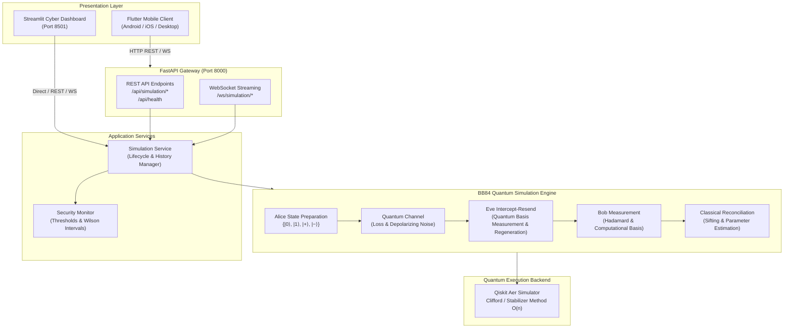
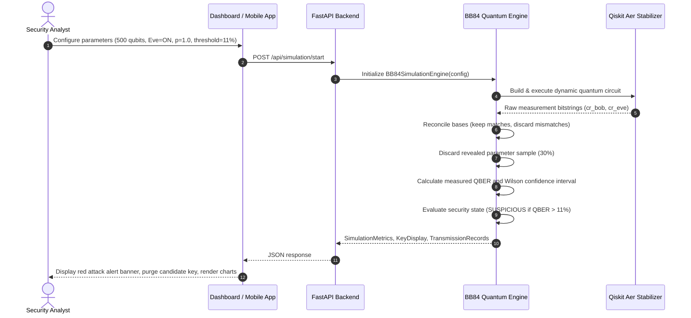

# QuantumShield System Architecture

## 1. High-Level Architecture Overview

QuantumShield is a production-grade, end-to-end quantum communication security and eavesdropping detection platform. The system simulates single-photon quantum state preparation, transmission, measurement, and basis reconciliation via **Qiskit** and **Qiskit Aer**, with real-time eavesdropping detection and statistical uncertainty analysis.

---

## 2. Core Components

### 2.1 Backend (`backend/app/`)

- **`core/bb84.py`**:
  Orchestrates the entire BB84 protocol lifecycle. Constructs vectorized and batched dynamic Qiskit circuits with quantum registers for Alice and Bob, and classical registers for Eve and Bob.
- **`core/attack_simulator.py`**:
  Implements the physical Intercept-Resend attack. Intercepts incoming qubits with probability $p_{eve}$, chooses an independent random measurement basis, measures the collapsed outcome, resets the state, and pre-prepares a replacement qubit state sent onward to Bob.
- **`core/quantum_channel.py`**:
  Simulates channel imperfections using a depolarizing noise model that introduces random Pauli $X$ (bit-flip), $Z$ (phase-flip), or $Y$ (both) operations.
- **`core/qber.py`**:
  Calculates empirical sifted-key QBER, sample QBER, theoretical expected values, and finite-sample 95% **Wilson Score Confidence Intervals**.
- **`core/security_monitor.py`**:
  Maintains rolling batch timeline, evaluates QBER against the configurable threshold (default 11.0%), checks minimum statistical sample size, and classifies runs into `SECURE`, `SUSPICIOUS`, or `INCONCLUSIVE`.
- **`core/backend_loader.py`**:
  Initializes `AerSimulator(method='stabilizer')` to achieve sub-second execution for thousands of qubits using Clifford tableau propagation.
- **`services/simulation_service.py`**:
  Manages in-memory simulation instances, history tracking, asynchronous batch generation for WebSocket streaming, and data exports (JSON & CSV).
- **`api/routes.py` & `api/websocket.py`**:
  FastAPI endpoints providing REST validation and WebSocket progress streams.

### 2.2 Streamlit Dashboard (`frontend/`)

- Built with modern dark cybersecurity aesthetics (`#07090E` background, violet `#7C3AED` and electric blue `#38BDF8` accents, emerald `#10B981` normal, and crimson `#EF4444` alerts).
- Dynamic Plotly visualizations:
  - Real-time radial QBER gauge with threshold zones.
  - Progression line chart of batch QBER with 11% alarm line.
  - Sifting yield breakdown donut chart.
  - Side-by-side normal vs. attacked comparison bar chart.
- Key material inspector with interactive bit unmasking and educational demonstration disclosures.
- Qubit-level transmission inspector detailing each photon's quantum path.

### 2.3 Flutter Mobile Application (`flutter_app/`)

- Cross-platform Dart/Flutter application (Android, iOS, Linux desktop).
- Connects to the FastAPI backend over REST and WebSockets.
- Configurable base URL with presets for Android emulators (`10.0.2.2`), localhost (`127.0.0.1`), and LAN physical devices.
- Uses `Provider` state management and `fl_chart` for real-time visualization.

---

## 3. Dataflow & Protocol Sequence

